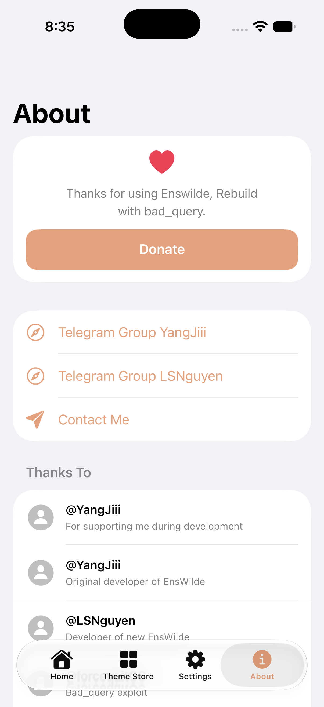

 

  

EnsWilde

Advanced iOS Customization & On-Device Patching Tool

  

    
    
    
    
  

Customize your device. Explore more possibilities.

⸻

About EnsWilde

EnsWilde is an advanced iOS customization utility designed to bring additional personalization and system-level modification capabilities to compatible iPhone and iPad devices.

Powered by the Worse_query and Airlift exploit implementations, EnsWilde provides tools for modifying selected system resources and customizing various aspects of the iOS experience.

Unlike traditional computer-dependent utilities, EnsWilde is designed to operate as a standalone, on-device application. Once the initial pairing and setup process is completed, users can access its supported features directly from their device without requiring a computer for every operation.

By leveraging available system vulnerabilities and supported file-writing mechanisms, EnsWilde can perform modifications beyond the application’s conventional sandbox boundaries.

[!WARNING]
Important Disclaimer

EnsWilde performs advanced system-level modifications. Incorrect usage or incompatible modifications may cause system instability, unexpected behavior, or bootloop issues.

* Always create a backup before using the application.
* Carefully review each feature before applying modifications.
* Compatibility depends on your iOS version, device configuration, and signing certificate.
* Use the application at your own risk.

The developers and contributors are not responsible for data loss, device malfunction, or other issues resulting from improper use.

⸻

Exploit & Compatibility

EnsWilde integrates two exploit implementations to support different iOS versions and device configurations.

Component	Supported Versions
Worse_query	iOS 27.0 – 27.3 Beta 1
Airlift	iOS 26.0 – 27.2 Beta 2

Compatibility Notes:

* Worse_query is intended for supported iOS 27 versions.
* Airlift provides pairing and file-operation capabilities for supported iOS 26 and iOS 27 versions.
* Exploit availability may vary depending on the exact firmware build.
* Not every feature is available on every supported iOS version.

⸻

Features

EnsWilde combines several customization and system modification utilities in one application.

1. Apple Wallet Customization

Personalize the appearance of Apple Wallet passes and cards by changing their background images.

2. MobileGestalt Editor

An advanced interface for modifying selected MobileGestalt configuration values.

This feature is intended for experienced users and requires the appropriate App Groups entitlement in the signing certificate.

3. Passcode Background Customization

Change the appearance of the iOS passcode keypad using the .passthm theme interface.

Create a more personalized lock-screen experience with custom passcode backgrounds.

4. On-Device Patching

Perform supported modifications directly on your iPhone or iPad.

After completing the initial setup, users can access available patching functionality without repeatedly connecting their device to a computer.

5. Disable Call Recording Sound

Provides an option to disable the notification beep associated with call recording on supported configurations.

6. Continuous Development

EnsWilde is actively evolving. More customization options, system utilities, and improvements are planned for future releases.

⸻

Screenshots

  
  &nbsp;
  
  &nbsp;
  

⸻

Getting Started

Requirements

Before using EnsWilde, make sure you have:

* A compatible iPhone or iPad.
* A supported iOS or iPadOS version.
* A properly signed EnsWilde installation.
* An appropriate pairing file for Airlift operations.
* A compatible signing certificate for features that require App Groups.

Setting Up Airlift

Follow these steps to prepare Airlift on your device.

Step 1 — Install LocalDevVPN

Download LocalDevVPN from the iOS App Store.

Step 2 — Enable VPN

Open LocalDevVPN and enable its VPN connection.

Step 3 — Launch EnsWilde

Open EnsWilde after completing the VPN setup.

Step 4 — Import Pairing File

The pairing process depends on your iOS version:

* iOS 26: Obtain the pairing file using iLoader on a computer, then open EnsWilde Settings and import the generated file.
* iOS 27: Obtain the pairing file directly on-device using StikPair, then import it into EnsWilde Settings.

[!NOTE]
Direct pairing inside EnsWilde on iOS 27 is planned for a future update.

⸻

Important Information

App Groups Entitlement

Worse_query now utilizes App Groups for its operations.

As a result, certain features require a signing certificate that supports the App Groups entitlement.

Without the required entitlement, some functionality — particularly MobileGestalt modifications — may not work correctly.

Signing Certificate

If you need a compatible certificate, you can find more information here:

* Cert YangJiii: https://cc.dangdi.dev

Please make sure your certificate supports the entitlements required by the features you intend to use.

⸻

Credits & Acknowledgements

EnsWilde would not be possible without the work, research, and contributions of the developers and projects listed below.

Contributor	Contribution
YangJiii	Development support and guidance
YangJiii	Original developer of EnsWilde
@forcequitOS	Creator of Worse_query
0xjohnnydev	Creator of Airlift
mak5er	Airlift on-device implementation research
@StikDebug Team	StikPair pairing-file functionality
DeepSeek	AI assistance during development

Original Projects

* YangJiii — https://github.com/YangJiiii/EnsWilde
* Worse_query — https://github.com/forcequitOS/worse_query/
* Airlift — https://github.com/0xjohnnydev/airlift
* AirCard-iOS — https://github.com/Mak5er/AirCard-iOS
* StikDebug — https://github.com/StikDebug

Special thanks to everyone who contributed to the research, development, testing, and improvement of the tools that make EnsWilde possible.

⸻

Disclaimer & Project Status

EnsWilde is an independent community project intended for educational, research, and device customization purposes.

This project is not affiliated with, endorsed by, or sponsored by Apple Inc.

Exploit compatibility, supported features, and installation requirements may change between releases. Always refer to the latest project documentation before applying modifications.

More updates and improvements are coming.

⸻

EnsWilde — Take Control of Your iOS Experience.

Made with Swift.

