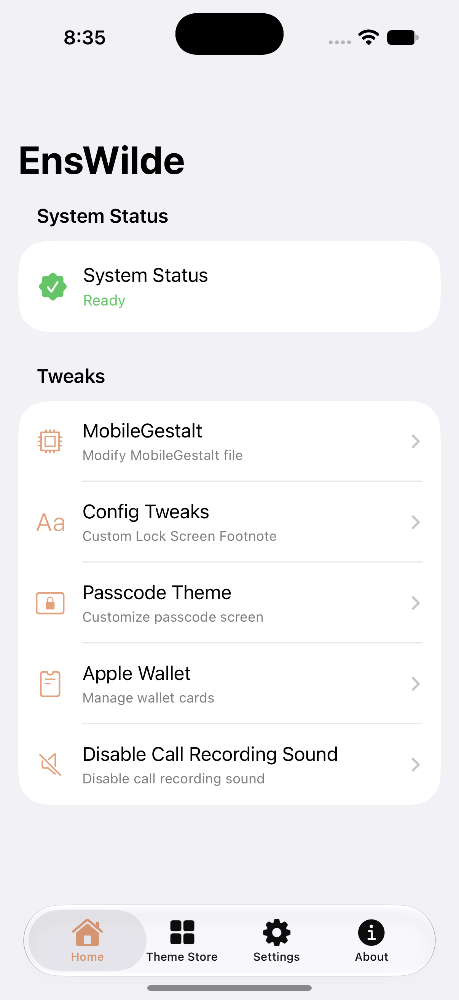
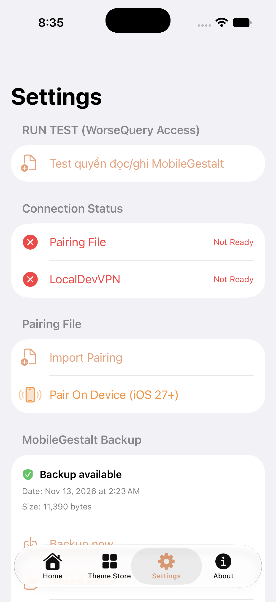
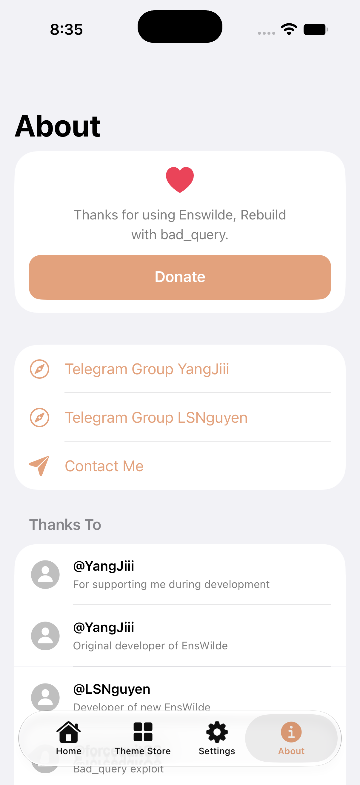

  

# EnsWilde (Mobile)
  

  
  

**EnsWilde** is a tool utilizing `Worse_query` & `Airlift` exploits, designed for iPhone and iPad running the  **Worse_query iOS Version 27.0-27.3 (24C5370i) Airlift iOS Version : 26.0-27.2 Beta 2**.

It operates as a standalone on-device application, functioning independently like modern apps. It leverages the `Bad_query` exploit to write data to files situated outside of the intended restore location.

> [!WARNING]
> **DISCLAIMER:**
> I am **not responsible** if your device enters a bootloop. Use this software with caution.
> **Please back up your data before using!**

---
## Exploit
• Worse_query : Support from iOS 27.0-27.3 Beta 1.
• Airlift : Support from iOS 26.0-27.2 Beta 2 (24B5089g).

---

## Features
* **Change Apple Wallet background image:** Customize the background appearance of Wallet passes/cards.
* **Edit MobileGestalt file (advanced):** Modify MobileGestalt configuration values (for advanced users).
* **Change Passcode background:** Customize the numeric keypad appearance using the `.passthm` interface.
* **On-device patching (no PC required):** Operates as a standalone app after the initial setup.
* **More features coming soon:** Development is ongoing to introduce additional capabilities.
* **Disable Call Recording Sound:** Disable the beep sound during call recording 
* For iOS 26, you need to retrieve the pairing file from your computer, then go to the app's settings and import the file you just obtained.

---

## Preview

  
  &nbsp;
  
  &nbsp;
  

---

## Usage Guides

## Setting Airlift
1. Download **LocaldevVPN** from the iOS App Store.
2. Enable the VPN inside the app.
3. Launch **EnsWilde**.
4. import Pairing File to setting page . iOS 26 using iloader , iOS 27 on device StikPair . Pairing directly in app on iOS 27 soon
## Need to know before continue
1. Worse_query now uses App Groups, it requires a certificate that supports this feature; `MobileGestalt` will only function if the App Group entitlement is present.
2. If you need a cert , you can buy at [Cert YangJiii](https://cc.dangdi.dev).

---

## Credits

Special thanks to the following for their contributions and support:

* **YangJiii**: [For supporting me during development](https://x.com/duongduong0908)
* **YangJiii**: [Original Developer of EnsWilde](https://github.com/yangjiiii/EnsWilde)
* **@forcequitOS**: [Worse_query](https://github.com/forcequitOS/worse_query/)
* **0xjohnnydev**: [Airlift](https://github.com/0xjohnnydev/airlift)
* **mak5er**: [Airlift-on-device Method](https://github.com/Mak5er/AirCard-iOS)
* **@StikDebug team**: [`StikPair`Get Pairing File](https://github.com/StikDebug)
* **DeepSeek**: Ai for this project