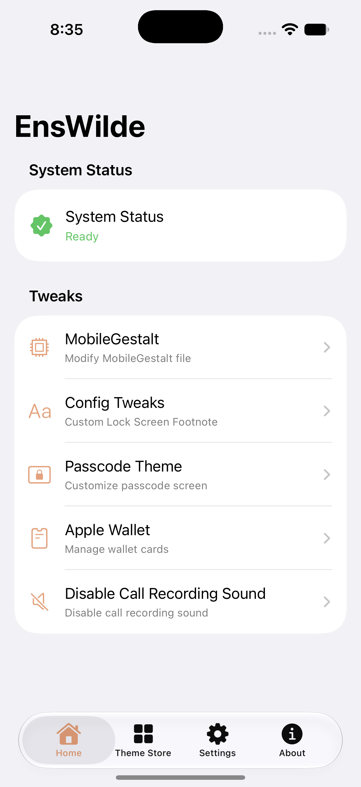
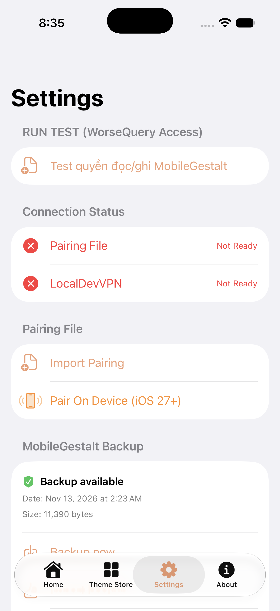

  

# EnsWilde (Mobile)
  

 
    
    
    

**EnsWilde** is an on-device customization tool for iPhone and iPad running iOS/iPadOS 26.0 – 27.3 Beta 1, using the `worse_query` and `AirLift` exploits. Once configured, it functions completely standalone without needing a computer (a PC is only required during initial setup on iOS 26).

It operates as a standalone on-device application, functioning independently like modern apps. It leverages the `Worse_query` exploit to write data to files situated outside of the intended restore location.

> [!WARNING]
> **DISCLAIMER:**
> I am **not responsible** for any bootloops, bricked devices, or data loss. Use this utility at your own risk.  
> **Always back up your device before proceeding!**

---
## Exploits & Compatibility
* **worse_query: Supports iOS 27.0-27.3 Beta 1.**
* **AirLift: Supports iOS 26.0-27.2 Beta 2 (Build 24B5089g).**
---

## Features
* **Apple Wallet Customization:** Change background images for Wallet passes and cards
* **MobileGestalt Editor (for advanced users):** Tweak hidden system properties and configuration keys.
* **Passcode Keypad Theming:** Customize your lock screen and dialer numpad with custom `.passthm` themes.
* **Disable Call Recording Announcement:** Mute the "This call is being recorded" audio prompt.
* **For iOS 26, you need to retrieve the pairing file from your computer, then go to the app's settings and import the file you just obtained.**
Tutorial how to generate pairing file on iOS <27 [Tutorial](https://vt.tiktok.com/ZSsSyKKAs/).
*More features in active development!*

---

## Preview

  
  &nbsp;
  
  &nbsp;
  

---

## Setting Airlift
1. Download **LocalDevVPN** from the App Store.
2. Open the app and toggle the VPN.
3. Launch **EnsWilde** and navigate to **Settings**.
4. Import your Pairing File:
   - **iOS 26:** Generate and retrieve the pairing file via PC using `idevice_pair`.
   - **iOS 27:** Dump the pairing file directly on-device using `StikPair`or **pair directly in-app EnsWilde for iOS 27**

## ⚠️ Important Prerequisites
1. **App Groups Entitlement:** `worse_query` requires App Groups to function. You must sign the app with a certificate that supports the App Group entitlement; otherwise, `MobileGestalt` modifications will not work.
2. **Need a signing certificate?** You can grab one at [Cert YangJiii](https://cc.dangdi.dev).

---

## Credits & Acknowledgments

Special thanks to everyone who made this project possible:

* **YangJiii**: [original developer of EnsWilde](https://github.com/yangjiiii/EnsWilde), support me and for guiding development.
* **@forcequitOS**: [for `worse_query`](https://github.com/forcequitOS/worse_query/)
* **0xjohnnydev**: [for `AirLift`](https://github.com/0xjohnnydev/airlift)
* **mak5er**: [for the on-device AirLift implementation](https://github.com/Mak5er/AirCard-iOS)
* **@StikDebug team**: [for `StikPair`](https://github.com/StikDebug)
* **@jailbreakdotparty**: [`Erosion` for config tweaks](https://github.com/jailbreakdotparty/Erosion)
* **@kianuni**: [`Erosion-CN` for write mobilegestalt logic](https://github.com/Kianuni/Erosion-CN)
* **@Litle_34306**: [`Original of Disable call recording sound`]
* **DeepSeek**: AI assistance during development